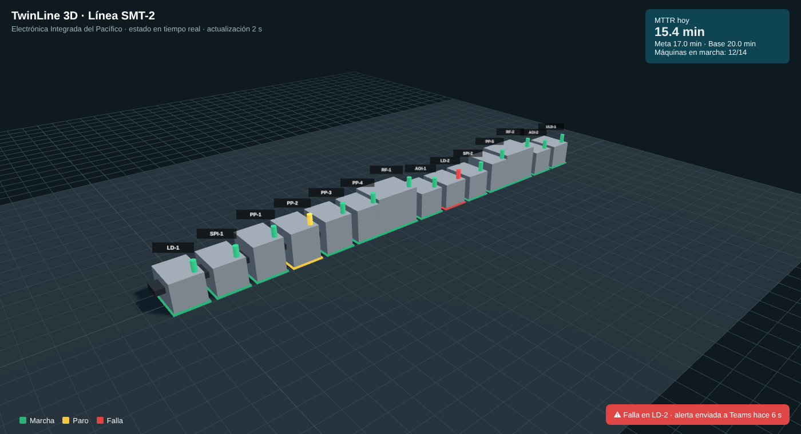

# EC0935 · TwinLine 3D — Gemelo digital de la Línea SMT-2

Expediente de evidencias para mi **certificación en el Estándar de Competencia EC0935 "Gestión de trabajo por proyectos"** (CONOCER).

> **Aviso:** es un proyecto **simulado con fines de evaluación**. La empresa *Electrónica Integrada del Pacífico, S.A. de C.V.*, las personas (excepto el líder), los proveedores, los montos y los resultados son **ficticios**. Cualquier parecido con empresas reales es coincidencia.

| | |
|---|---|
| **Candidato / líder del proyecto** | Jesús Roberto Aragón López ([@RobiiAragon](https://github.com/RobiiAragon)) |
| **Formación** | Ing. en Entornos Virtuales y Negocios Digitales · Universidad Tecnológica de Tijuana |
| **Periodo del proyecto** | 03/08/2026 – 20/11/2026 (16 semanas) |
| **Estándar** | EC0935 · Nivel 4 · 5 elementos (E2922 – E2926) |
| **Antecedente** | Derivado individual del proyecto en equipo *Deko3D* del cuatrimestre, sin sus errores (ver la matriz) |

## ¿De qué trata el proyecto?
Una maquiladora en Tijuana tarda en promedio **20 minutos** en atender un paro de máquina porque los paros se avisan por radio y se anotan en papel. **TwinLine 3D** instala sensores IoT no invasivos (ESP32) en cada máquina y muestra la línea completa en un **visor 3D web (Three.js)**: cada máquina se pinta de verde, amarillo o rojo en tiempo real y el técnico recibe una alerta en Microsoft Teams.

**Resultado:** el MTTR bajó de 20.0 a **16.5 min (−17.5%)**, por arriba de la meta de −15%, con un costo final de **$223,300 MXN** de $233,000 autorizados.



## Estructura del expediente
Cada documento viene en **.docx** (editable) y **.pdf** (para entregar).

```
1. Inicio/            E2922  1.1 Plan Básico · 1.2 Minuta Junta de Inicio
2. Organizacion/      E2923  2.1 Plan Detallado · 2.2 Minuta de presentación del plan
3. Implementacion/    E2924  3.1 Paquetes por externos · 3.2 Proveedores calificados
                             3.3 Trabajo por proveedor · 3.4 Verificación de avance · 3.5 Evidencias
4. Verificacion/      E2925  4.1 Cambios autorizados · 4.2 Estado actual · 4.3 Verificación de paquetes
5. Finalizacion/      E2926  5.1 Reporte final · 5.2 Minuta junta de cierre
evidencias/img/              Capturas y gráficas usadas como evidencia
anexos/                      A-02 a A-12: actas, reportes y registros firmados
viewer/                      Código del visor 3D de referencia (Three.js)
fuente/                      Scripts que generan todos los documentos
MATRIZ_EC0935.md             Cada criterio del estándar → documento donde se cumple
```

## Cumplimiento del estándar
La [**matriz de cumplimiento**](MATRIZ_EC0935.md) relaciona **cada criterio de evaluación** de los 5 elementos con el documento y la sección que lo cubre, e incluye la tabla de errores del proyecto de referencia que se corrigieron.

## Firmas
Los documentos ya están firmados. La firma del líder es la mía, tomada de los documentos de Deko3D. Las firmas del dueño y de los demás participantes son **simuladas**, igual que esas personas (se generan con `fuente/sigs.py`). Las imágenes originales de las firmas no se suben al repo (`fuente/sig/` está en `.gitignore`).

## Regenerar los documentos
```bash
cd fuente
npm i docx                      # generador de .docx
python3 imgs.py                 # gráficas en fuente/img/
node build.js ../salida         # crea las 5 carpetas con los .docx
node anexos.js ../salida        # crea los anexos A-02 a A-12
# PDF: soffice --headless --convert-to pdf *.docx (en cada carpeta)
```
Los datos (personas, paquetes, costos y cambios) están en `fuente/data.js`; los totales se calculan y se validan automáticamente.

## Visor 3D de referencia
```bash
cd viewer && npm i && npx serve .   # abrir http://localhost:3000
```

---
Jesús Roberto Aragón López · Tijuana, B.C. · 2026
